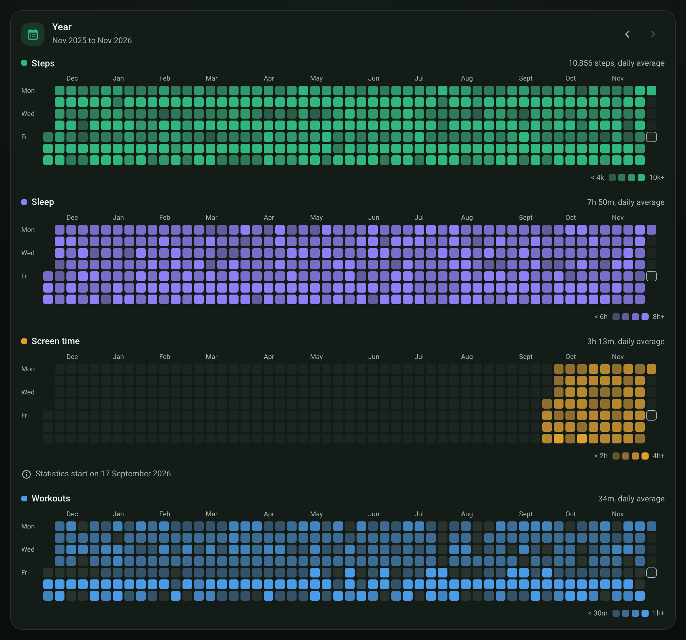
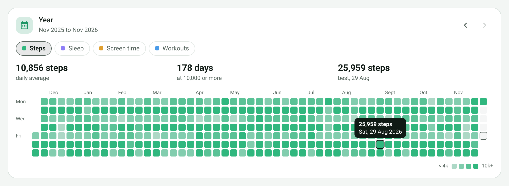
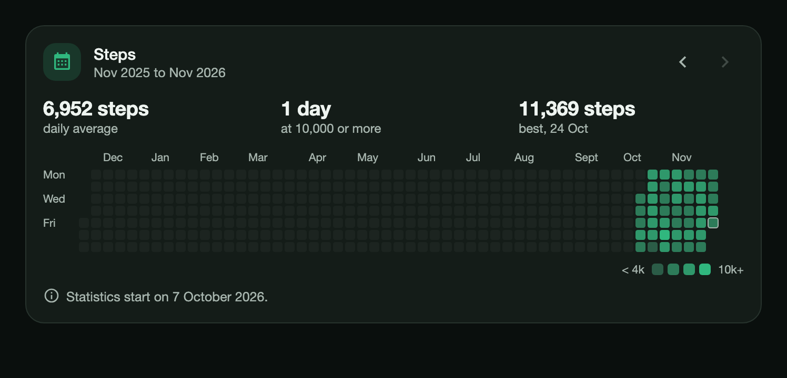
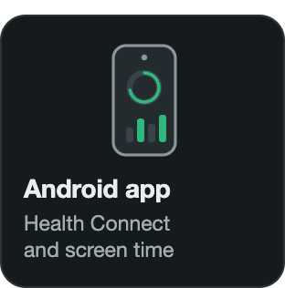
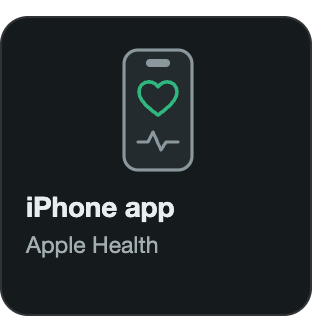
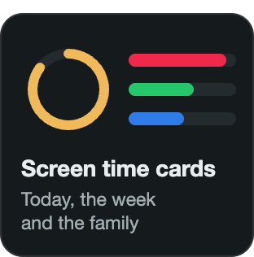
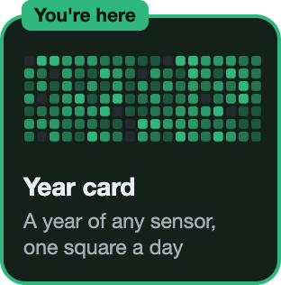
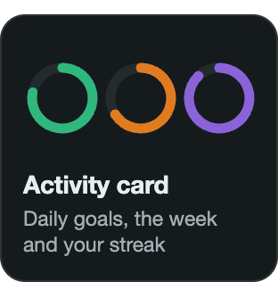
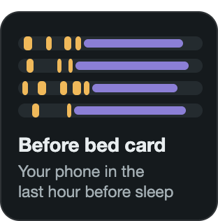

<p align="center">
  
</p>

<h1 align="center">Life Dashboard Year Card</h1>

<p align="center">
  <b>A year of any sensor on your Home Assistant dashboard, one square per day.</b><br>
  Steps, sleep, screen time, workouts or anything else with long-term statistics, colored by thresholds you set.
</p>

<p align="center">
  <a href="https://github.com/owen282000/life-dashboard-year-card/releases/latest"></a>
  <a href="https://www.home-assistant.io/"></a>
  <a href="https://github.com/owen282000/life-dashboard-year-card/blob/main/LICENSE"></a>
</p>

<p align="center">
  <a href="https://github.com/owen282000/life-dashboard-year-card#install"><b>Install</b></a>
  &nbsp;·&nbsp;
  <a href="https://github.com/owen282000/life-dashboard-year-card#configure">Configure</a>
  &nbsp;·&nbsp;
  <a href="https://github.com/owen282000/life-dashboard-year-card#works-with-any-sensor">Any&nbsp;sensor</a>
  &nbsp;·&nbsp;
  <a href="https://owen282000.com/life-dashboard/">Website</a>
</p>

<p align="center">
  <sub>Life Dashboard: <a href="https://github.com/owen282000/life-dashboard-companion-app">Android app</a> &nbsp;·&nbsp; <a href="https://github.com/owen282000/life-dashboard-companion-app-ios">iPhone app</a> &nbsp;·&nbsp; <a href="https://github.com/owen282000/life-dashboard-ha">Home Assistant integration</a> &nbsp;·&nbsp; <a href="https://github.com/owen282000/life-dashboard-stack">Grafana stack</a> &nbsp;·&nbsp; <a href="https://github.com/owen282000/life-dashboard-sleep-card">Sleep card</a> &nbsp;·&nbsp; <a href="https://github.com/owen282000/life-dashboard-screen-time-card">Screen time cards</a> &nbsp;·&nbsp; <b>Year card</b></sub>
</p>

<p align="center">
  <picture>
    <source media="(max-width: 600px)" srcset="https://raw.githubusercontent.com/owen282000/life-dashboard-year-card/main/docs/readme-hero-phone.png">
    
  </picture>
  <br><sub>Sample data from made-up phones</sub>
</p>

The card reads Home Assistant's long-term statistics and draws a year of them: a column per week, a square per day, darker for more. It works with any sensor that has statistics, from Fitbit, Garmin, Withings or the Companion app, and starts on the day that sensor was added. With the [Life Dashboard app](https://github.com/owen282000/life-dashboard-companion-app) the year is already there, because the app sends your history along.

<a href="https://play.google.com/store/apps/details?id=com.owen282000.lifedashboard&referrer=utm_source%3Dgh-yearcard-readme%26utm_medium%3Dreadme"></a> <a href="https://apps.apple.com/app/apple-store/id6824075761?pt=128699800&ct=gh-yearcard-readme&mt=8"></a>

## What you get

- **A year at a glance.** One square per day, in four steps of one color. A day that counted nothing is gray, a day without data is nearly blank, so a gap reads as a gap.
- **Several metrics in one card.** Switch between them with the buttons above the grid, or show them all below each other.
- **Your own scale.** Thresholds per metric, such as 4000, 7000 and 10000 steps. Without them, steps, sleep, screen time and exercise get sensible ones, and any other sensor gets a scale from its own values.
- **The figures above it.** The daily average, the days that reached your highest threshold, and the best day with its date.
- **This year, and the ones before.** The calendar year or the last twelve months, with buttons to page back a year at a time.
- **Every day on demand.** Hover or tap a square for its date and value. On a keyboard, focus the grid and use the arrow keys, Home and End. Screen readers get the months as a table.
- **Your locale and theme.** English, Arabic, Chinese, Dutch, French, German, Hindi, Italian, Japanese, Portuguese and Spanish, the week starting where your profile says, and your theme's colors in light and dark.

<p align="center">
  
  <br><sub>Sample data</sub>
</p>

## Install

### Through the Home Assistant Marketplace

The card is not in the Marketplace's default list yet. Until it is, add it as a custom repository: in **Settings > Marketplace** (HACS before Home Assistant 2026.11), open the three dots, **Custom repositories**, and add `https://github.com/owen282000/life-dashboard-year-card` as the type **Dashboard**. Then search for **Life Dashboard Year Card** and download it. This button does the same in your Home Assistant:

[](https://my.home-assistant.io/redirect/hacs_repository/?owner=owen282000&repository=life-dashboard-year-card&category=plugin)

On storage mode dashboards the resource is registered for you. If your dashboards are in YAML mode, add it yourself:

```yaml
lovelace:
  resources:
    - url: /hacsfiles/life-dashboard-year-card/life-dashboard-year-card.js
      type: module
```

### By hand

Copy `dist/life-dashboard-year-card.js` into the `www` folder of your Home Assistant configuration and add it as a resource of the type JavaScript module with the URL `/local/life-dashboard-year-card.js`.

## Configure

Add the card from the card picker, which has a visual editor, or in YAML. One sensor is enough:

```yaml
type: custom:life-dashboard-year-card
entity: sensor.your_phone_daily_steps
```

Several metrics, each with its own name, color and thresholds:

```yaml
type: custom:life-dashboard-year-card
title: My year
period: rolling
layout: rows
metrics:
  - entity: sensor.your_phone_steps_today
    thresholds: [4000, 7000, 10000]
  - entity: sensor.your_phone_last_sleep_duration
    name: Sleep
    color: "#8f7ff7"
    thresholds: [6, 7, 8]
  - entity: sensor.bathroom_scale_weight
    name: Weight
    aggregate: mean
  - entity: sensor.solar_energy_today
    name: Solar
    color: "#e0a030"
```

| Option | Default | Description |
| --- | --- | --- |
| `type` | | `custom:life-dashboard-year-card` |
| `metrics` | | The list of what to show, at most eight. See below |
| `entity` | | Short for one metric with only a sensor |
| `title` | Year | Text at the top of the card |
| `period` | `calendar` | `calendar` for 1 January to 31 December, `rolling` for the last twelve months |
| `layout` | `tabs` | `tabs` shows one metric at a time, `rows` all of them below each other |

Per metric:

| Option | Default | Description |
| --- | --- | --- |
| `entity` | | A sensor with long-term statistics |
| `statistic` | | A statistic id instead of a sensor, for statistics an integration imports without a sensor of their own |
| `name` | the sensor's name | The label on the button or above the grid |
| `color` | by kind, else from a palette | The darkest square's color: a hex value, a color name or a theme variable such as `var(--accent-color)` |
| `thresholds` | by kind, else from the data | Up to six ascending values in the statistic's unit. Three thresholds give four steps of color |
| `aggregate` | `auto` | The day's value: `sum`, `max`, `mean` or `min`. `auto` takes the day's total for a sensor that counts up, and the highest value of the day for a measurement |

Thresholds are in the unit the statistic is kept in: hours for a sleep sensor in hours, minutes for one in minutes. Language, first day of the week and time zone follow Home Assistant.

## Works with any sensor

The card needs no integration of mine. Any sensor that Home Assistant keeps long-term statistics for will do, which means it has a state class: the Companion app's daily steps, a Fitbit, Garmin or Withings sensor, a `history_stats` sensor for screen time, an energy meter, a rain gauge.

<p align="center">
  
  <br><sub>Sample data: a step sensor that was added six weeks ago</sub>
</p>

Statistics start on the day a sensor is added to Home Assistant, so the grid starts there too and fills in a day at a time. The card says from which date it has data. The current day shows up within the hour, when Home Assistant writes its statistics.

## Gets more with the Life Dashboard app

The [Life Dashboard app](https://github.com/owen282000/life-dashboard-companion-app) for Android and [for iPhone](https://github.com/owen282000/life-dashboard-companion-app-ios) sends what Health Connect or Apple Health holds to the [Life Dashboard integration](https://github.com/owen282000/life-dashboard-ha), which writes every day into long-term statistics on its own date. Pick one of its sensors and the card reads that history instead of the sensor's own:

- **Steps, sleep and workouts go back in time.** After **Send history** in the app the grid shows the days you already had, up to a year back, instead of starting today.
- **Screen time starts when you install.** It is Android only, and a phone only hands over about the last week, so that grid fills in from the first sync on. An iPhone has no screen time for apps to read.
- **Nothing to set up.** The card picker starts with the phone's steps, sleep, screen time and exercise, each with its name, color and thresholds.

<a href="https://play.google.com/store/apps/details?id=com.owen282000.lifedashboard&referrer=utm_source%3Dgh-yearcard-readme%26utm_medium%3Dreadme">Life Dashboard on Google Play</a> &nbsp;·&nbsp; <a href="https://apps.apple.com/app/apple-store/id6824075761?pt=128699800&ct=gh-yearcard-readme&mt=8">Life Dashboard on the App Store</a> &nbsp;·&nbsp; free to build yourself from [GitHub](https://github.com/owen282000/life-dashboard-companion-app), and on F-Droid for Android

## Colors

The colors of the four kinds the card recognizes are CSS variables, so a theme can set them. A `color` on a metric always wins.

| Variable | Default |
| --- | --- |
| `--life-dashboard-year-steps` | `#30b77e` |
| `--life-dashboard-year-sleep` | `#8f7ff7` |
| `--life-dashboard-year-screen-time` | `#e0a030` |
| `--life-dashboard-year-workouts` | `#4a9be8` |

## Part of Life Dashboard

This card sits on top of Life Dashboard's projects, and you only install the parts you need. More at [owen282000.com/life-dashboard](https://owen282000.com/life-dashboard/).

<p align="center">
  <sub><b>On your phone</b></sub><br>
  <a href="https://github.com/owen282000/life-dashboard-companion-app"><picture><source media="(prefers-color-scheme: light)" srcset="https://raw.githubusercontent.com/owen282000/life-dashboard-year-card/main/docs/family/android-light.png"></picture></a>
  <a href="https://github.com/owen282000/life-dashboard-companion-app-ios"><picture><source media="(prefers-color-scheme: light)" srcset="https://raw.githubusercontent.com/owen282000/life-dashboard-year-card/main/docs/family/ios-light.png"></picture></a>
</p>

<p align="center">
  <sub><b>Where the data goes</b></sub><br>
  <a href="https://github.com/owen282000/life-dashboard-ha"><picture><source media="(prefers-color-scheme: light)" srcset="https://raw.githubusercontent.com/owen282000/life-dashboard-year-card/main/docs/family/ha-light.png"></picture></a>
  <a href="https://github.com/owen282000/life-dashboard-stack"><picture><source media="(prefers-color-scheme: light)" srcset="https://raw.githubusercontent.com/owen282000/life-dashboard-year-card/main/docs/family/stack-light.png"></picture></a>
</p>

<p align="center">
  <sub><b>Cards for your Home Assistant dashboard</b></sub><br>
  <a href="https://github.com/owen282000/life-dashboard-sleep-card"><picture><source media="(prefers-color-scheme: light)" srcset="https://raw.githubusercontent.com/owen282000/life-dashboard-year-card/main/docs/family/sleep-card-light.png"></picture></a>
  <a href="https://github.com/owen282000/life-dashboard-screen-time-card"><picture><source media="(prefers-color-scheme: light)" srcset="https://raw.githubusercontent.com/owen282000/life-dashboard-year-card/main/docs/family/screen-time-card-light.png"></picture></a>
  <picture><source media="(prefers-color-scheme: light)" srcset="https://raw.githubusercontent.com/owen282000/life-dashboard-year-card/main/docs/family/year-card-here-light.png"></picture>
  <a href="https://github.com/owen282000/life-dashboard-activity-card"><picture><source media="(prefers-color-scheme: light)" srcset="https://raw.githubusercontent.com/owen282000/life-dashboard-year-card/main/docs/family/activity-card-light.png"></picture></a>
  <a href="https://github.com/owen282000/life-dashboard-before-bed-card"><picture><source media="(prefers-color-scheme: light)" srcset="https://raw.githubusercontent.com/owen282000/life-dashboard-year-card/main/docs/family/before-bed-card-light.png"></picture></a>
</p>

## Privacy

The card only reads what Home Assistant already gives your browser: the recorder's statistics and the sensors' names. It makes no requests of its own, has no telemetry or analytics, and there's no server of mine in the path.

## Documentation

- [Changelog](https://github.com/owen282000/life-dashboard-year-card/blob/main/CHANGELOG.md)
- [The Health dashboard](https://github.com/owen282000/life-dashboard-ha/blob/main/docs/dashboard.md) of the integration, to put this card on

## Help and contributing

Bugs go to [issues](https://github.com/owen282000/life-dashboard-year-card/issues) here. Questions go to the integration's [Discussions](https://github.com/owen282000/life-dashboard-ha/discussions). No GitHub account? Use the [feedback board](https://owen282000.com/life-dashboard/feedback/), which needs no account. Everything on it is public, so leave out health data, logs and webhook URLs.

Pull requests are welcome, see [CONTRIBUTING](https://github.com/owen282000/life-dashboard-year-card/blob/main/CONTRIBUTING.md). The card is one JavaScript file with no dependencies and no build step. Security problems go through a [private advisory](https://github.com/owen282000/life-dashboard-year-card/security/advisories/new).

## Support the project

Stars, shares and good bug reports all help. If you want to chip in for the evenings that go into it, there's [Ko-fi](https://ko-fi.com/owen282000). The card stays free and open source (MIT) either way.

MIT licensed. See [LICENSE](https://github.com/owen282000/life-dashboard-year-card/blob/main/LICENSE).

<p align="center">
  <sub>Made by <a href="https://github.com/owen282000">Owen Vogelaar</a> for the self-hosting and quantified self crowd.</sub><br>
  <sub>Google Play and the Google Play logo are trademarks of Google LLC.</sub><br>
  <sub>Apple, the Apple logo and App Store are trademarks of Apple Inc.</sub>
</p>
